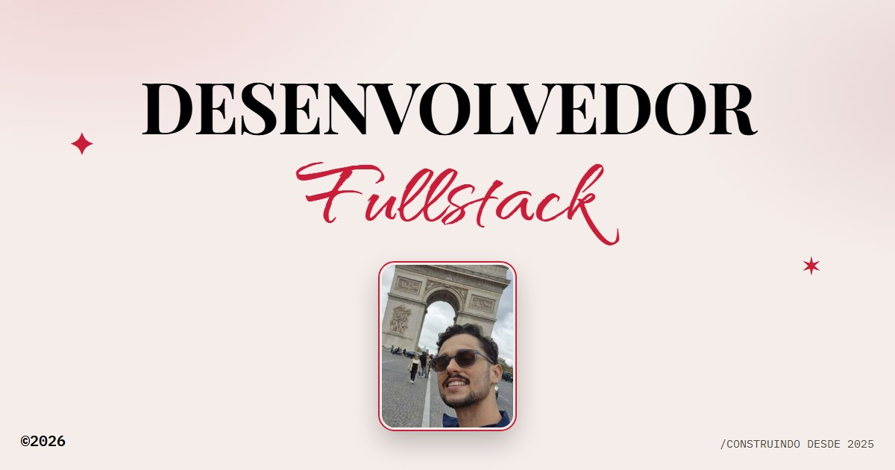

# Ricardo Juliano, Desenvolvedor Fullstack

Meu portfólio pessoal: uma página única com quem eu sou, no que trabalho e os projetos que já construí.

**Ver online:** https://meu-portfolio-sigma-self.vercel.app



## Sobre mim

Sou desenvolvedor fullstack em transição de carreira, de Buenópolis, MG. Trabalho com React e TypeScript no front-end e Node/Express com PostgreSQL no back-end, e tenho experiência com Android nativo em Kotlin. Estou buscando minha primeira oportunidade como desenvolvedor.

## Projetos em destaque

| Projeto | O que é | Stack |
|---|---|---|
| [Boutique Arco-Íris](https://github.com/RicardoJuliano/Boutique-Arco-ris) ([demo](https://boutique-arco-ris.vercel.app)) | E-commerce com consultora de estilo por IA | React, TypeScript, Node/Express, JWT, API da Anthropic |
| [Vende no Zap](https://github.com/RicardoJuliano/vende-no-zap) ([demo](https://vende-no-zap.vercel.app)) | CRM com cobrança Pix para quem vende pelo WhatsApp | Next.js, Supabase, Zod, Vitest |
| [trokei](https://github.com/RicardoJuliano/trokei) ([demo](https://trokei-seven.vercel.app)) | Brechó online com catálogo e cadastro de produtos | HTML, CSS, JavaScript |
| [Resumo Fácil (booktube)](https://github.com/RicardoJuliano/booktube) | Automação de vídeos-resumo de livros | Node, FFmpeg, Claude, ElevenLabs |
| [StudyTaks](https://github.com/RicardoJuliano/StudyTaks) | Monitoramento de progresso de estudos | Kotlin |
| [Touch Hero](https://github.com/RicardoJuliano/Touch-Hero) | Jogo estilo Guitar Hero com detecção de toques | Kotlin |
| [Landing Pages](https://github.com/RicardoJuliano/landinpages) | Estudos de design responsivo | HTML5, CSS3 |

## Como o site foi feito

- **HTML, CSS e JavaScript puros**, sem framework e sem etapa de build. Tudo está em um único `index.html`.
- **Animações de entrada** ao rolar a página, feitas com `IntersectionObserver`.
- **Vídeos dos cards** só tocam enquanto estão visíveis na tela, para economizar dados e bateria.
- **Layout responsivo**, com menu para celular e ajustes para telas estreitas.
- **Sem JavaScript:** o conteúdo continua visível se o script não carregar.
- **Compartilhamento:** metatags Open Graph e Twitter Card, com imagem de prévia.
- **Fontes:** Playfair Display, Qwitcher Grypen e IBM Plex Mono, via Google Fonts.

## Rodando localmente

Não precisa instalar nada. Clone o repositório e abra o arquivo no navegador:

```bash
git clone https://github.com/RicardoJuliano/meu-portfolio.git
cd meu-portfolio
```

Abra o `index.html`, ou, se preferir um servidor local:

```bash
npx serve .
```

## Estrutura

```
meu-portfolio/
├── index.html   # página inteira (HTML, CSS e JS)
├── img/         # fotos, capas dos projetos e imagem de prévia
└── video/       # vídeos curtos dos cards
```

## Contato

- E-mail: rjulianojunior@gmail.com
- GitHub: [RicardoJuliano](https://github.com/RicardoJuliano)
- LinkedIn: [ricardo-juliano](https://www.linkedin.com/in/ricardo-juliano)
